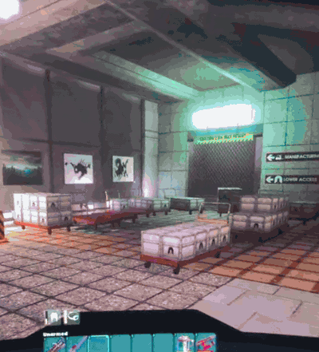

# Cart Return

A [UE4SS](https://github.com/UE4SS-RE/RE-UE4SS) Lua mod for **Abiotic Factor**
that recalls your Platform Carts to wherever you're standing.

The game only lets you recover carts from the button in the Office Sector.
This mod lets you recall them anywhere, so a base doesn't have to sit near
that button.

The cart actor itself is moved, so everything in its inventory comes with it.

> **Status:** untested in-game. The cart class name is guessed (see
> [Troubleshooting](#troubleshooting)). Reports and scan output are welcome.

## Controls

| Key | Action |
| --- | --- |
| `F6` | Recall the nearest cart to just in front of you |
| `F7` | Recall every loaded cart, lined up in front of you |
| `F8` | Scan: print cart classes and related game functions to `UE4SS.log` |
| `F9` | Empty every cart into loot bags at your feet, using the game's own recall. The carts go back to their spawn, like with the security booth button. |

Keys and placement are configurable at the top of
[`CartReturn/Scripts/main.lua`](CartReturn/Scripts/main.lua).

## Installation

**New to modding? Follow the [step-by-step install guide](INSTALL.md).** It also
covers updating and uninstalling.

Quick version:

1. Install [AF-UE4SS](https://github.com/igromanru/AF-UE4SS/releases). Put
   `dwmapi.dll` and the `ue4ss` folder next to `AbioticFactor-Win64-Shipping.exe`
   (`Binaries\Win64`, or `Binaries\WinGDK` for Game Pass).
2. Download `CartReturn-v*.zip` from [Releases](../../releases) and extract the
   `CartReturn` folder into `ue4ss\Mods\`.
3. **Linux / Steam Deck only:** set the game's Steam launch options to
   `WINEDLLOVERRIDES="dwmapi=n,b" %command%`, or Proton won't load UE4SS.
4. Launch the game. `ue4ss\UE4SS.log` should contain `[CartReturn] v1.2.0 loaded.`
   (The UE4SS console is off by default in AF-UE4SS.)

## Troubleshooting

### "No carts found"

The mod looks for actors deriving from `AbioticDeployed_ParentBP_C` whose class
name contains `platformcart`. Neither name has been confirmed against the game
yet. To find the right one:

1. Stand near a deployed Platform Cart and press `F8`.
2. In `ue4ss\UE4SS.log`, look for a `Found cart:` line or the list of
   `Class names containing 'cart'`. If nothing shows up, set
   `GuiConsoleEnabled = 1` and `GuiConsoleVisible = 1` in
   `ue4ss\UE4SS-settings.ini`, restart, and search for `Cart` in the
   **Live View** tab (toggle the window with Ctrl+O).
3. Put the class name in `CART_CLASSES` in `main.lua`, or adjust `CART_MATCH`
   / `DEPLOYABLE_PARENT`.

Please open an issue with the scan output so the defaults can be fixed.

## Limitations

- **Multiplayer:** moving world actors needs server authority. Single-player
  and the host work. A client gets a warning and the move may not replicate,
  so the host should do the recall.
- `F9` uses the game's recall button, so that button has to be loaded (you
  may need to be in or near the Office Sector).
- Recalled carts appear at a fixed height above you and drop to the floor.
  In tight spaces they can clip into geometry.

## License

[MIT](LICENSE)
